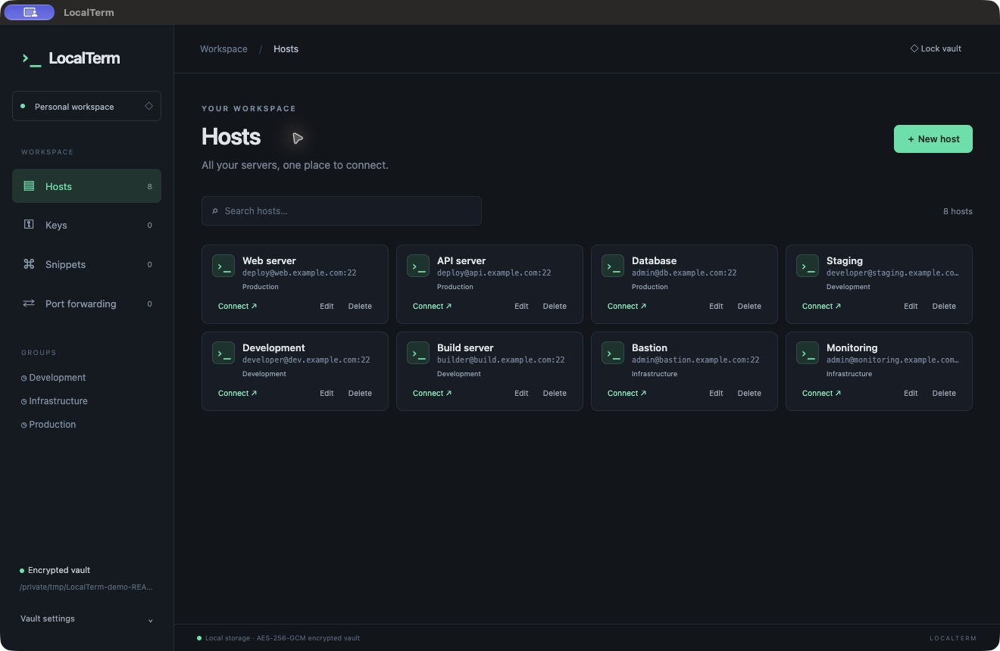

# LocalTerm 1.7.0

Helyi SSH-kliens macOS-re és Windowsra, hordozható, jelszóval titkosított vaulttal. A közös forrás ebben a repóban található; a kész alkalmazások külön platformmappákban vannak.



## Letöltés

| Platform | Kész csomag |
|---|---|
| macOS / Apple Silicon | [Mac ZIP](https://github.com/x0r3n/LocalTerm/releases/download/v1.7.0/LocalTerm-1.7.0-Mac-AppleSilicon.zip) |
| Windows / Intel–AMD x64 | [Portable EXE](https://github.com/x0r3n/LocalTerm/releases/download/v1.7.0/LocalTerm-1.7.0-Windows-x64-Portable.exe) · [Teljes ZIP](https://github.com/x0r3n/LocalTerm/releases/download/v1.7.0/LocalTerm-1.7.0-Windows-x64.zip) |

A kész alkalmazásokat a [GitHub Release v1.7.0](https://github.com/x0r3n/LocalTerm/releases/tag/v1.7.0) mellékleteiből töltheted le, Git és Git LFS telepítése nélkül. Node.js vagy Electron külön telepítése sem szükséges. A csatolt fájlok ellenőrzőösszegei: [SHA256SUMS.txt](https://github.com/x0r3n/LocalTerm/releases/download/v1.7.0/SHA256SUMS.txt).

Telepítés, macOS-karanténjelölés kezelése és részletes használat: [macOS útmutató](docs/macos.md) · [Windows útmutató](docs/windows.md).

## Funkciók

- Hostok, csoportok, jelszavak, privát kulcsok és snippetek egy titkosított `.ltvault` fájlban.
- SSH, kereshető terminálfülek és egérrel elrendezhető osztott Workspace-nézetek.
- SFTP-listázás, feltöltés és letöltés; Local, Remote és Dynamic/SOCKS5 porttovábbítás.
- Többlépcsős ugróhostok, hostujjlenyomat-ellenőrzés és az utolsó vaultútvonal megjegyzése.
- Állítható automatikus zárolás, külön képernyőzár- és alvómód-kapcsolókkal.
- **1.5.5:** a terminál kijelölése automatikusan másol, a jobb kattintás a kattintott panelbe illeszt. Alapból bekapcsolt; kikapcsolás a **Vault settings → Terminal clipboard** résznél, majd **Save clipboard settings**. A beállítás a titkosított vaultban megmarad.

A Macen és Windowson használt vaultformátum azonos. AES-256-GCM titkosítás és scrypt jelszószármaztatás használatos. A vault jelszava nem kerül mentésre. Szinkronizált mappában is használható a helyi fájl, de egyszerre csak egy gépen szerkeszd, és készíts biztonsági másolatot.

## A repó felépítése

```text
src/                       Közös alkalmazásforrás
test/                      Automatizált tesztek
docs/macos.md              Mac telepítés és használat
docs/windows.md            Windows telepítés és használat
builds/macos/1.7.0/         Mac build (Git LFS)
builds/windows/1.7.0/       Windows buildek (Git LFS)
releases/1.7.0/             Teljes forrásarchívum
```

A nagy buildfájlok Git LFS-ben vannak. Klónozáshoz telepítsd a [Git LFS-t](https://git-lfs.com/), majd:

```sh
git lfs install
git clone git@github.com:x0r3n/LocalTerm.git
cd LocalTerm
git lfs pull
```

A GitHub automatikus **Download ZIP** forrásletöltésében a buildek helyett LFS-hivatkozások lehetnek. A kész alkalmazást a fenti platformlinkről, a teljes forrást a [külön forráscsomagból](https://github.com/x0r3n/LocalTerm/releases/download/v1.7.0/LocalTerm-1.7.0-source.zip) töltsd le.

## Fejlesztés és build

JavaScript/CommonJS, Electron, xterm.js és ssh2. Node.js 22 vagy újabb, valamint npm szükséges:

```sh
npm ci
npm test
npm start
npm run build       # macOS Apple Silicon Macen
npm run build:win   # Windows x64 ZIP és portable EXE
```

A csomagok a `dist/` mappába kerülnek. Az SSH-integrációs tesztek helyi TCP-portokat használnak. Az 1.5.6 kiadásnál 71 teszt sikeres macOS-en; a kijelöléses másolást, jobb kattintásos beillesztést és a kapcsolót natív Mac-felületen, szintetikus SSH-szerverrel is ellenőriztük. Windows-futtatási környezetben ez a kiadás még nem volt tesztelve. A kiadások nincsenek digitálisan aláírva; a Mac-build nincs notarizálva.

## Licenc

Copyright © 2026 **x0r3n**. A LocalTerm [GNU GPL 3.0, kizárólag a 3. verzió szerint](LICENSE) (`GPL-3.0-only`) használható. A szerzői jogi nyilatkozat a [COPYRIGHT](COPYRIGHT) fájlban van. A programra nincs garancia. A külső függőségek eredeti licencei és copyright-értesítői megmaradnak; a csomagok tartalmazzák az Electron és Chromium licencértesítőit is.

A korábban MIT alatt kiadott példányokra kapott jogosultságokat a GPL-re váltás nem vonja vissza.

## Hostonkénti termináltémák (1.5.6)

**Hosts → Edit → Terminal theme**: minden hosthoz külön téma menthető. Választható a **Default**, a vöröses **Ember Dune**, a zöldes **Emerald** és a világos **Paper**, továbbá a **Custom** mód. Minden meglévő és új host alapértelmezése a korábbi, változatlan LocalTerm-színvilág.

Custom módban külön beállítható a háttér, a betűszín, a kurzor, a kijelölés háttere és a kijelölt szöveg színe. Színválasztó és hatjegyű hex mező is használható, élő előnézettel. A **Save changes** az adott hosttal együtt, a titkosított vaultba menti a témát. Az adott host már nyitott termináljai újracsatlakozás nélkül frissülnek, a többi host színei megmaradnak. A Default választás visszaállítja az eredeti színeket.

Az 1.5.6 kiadásnál 71 automatizált teszt sikeres macOS-en, beleértve a témák validálását, a titkosított mentést, az importot és a nyitott terminálok frissítését. A témaelőnézetet és az egyéni színek élő alkalmazását natív Mac-felületen, szintetikus SSH-kapcsolaton is ellenőriztük.

## Application updates (1.6.0)

After the first vault unlock of the day, LocalTerm checks the latest stable release at https://github.com/x0r3n/LocalTerm/releases. The check date is stored locally on this computer. Vault settings also contains **Check for updates**, which runs a check immediately.

When an update is available, choose **Update now** or **Later**. Updates are never installed automatically. LocalTerm downloads the matching macOS Apple Silicon ZIP or Windows x64 portable executable and verifies its size and SHA-256 digest against GitHub release metadata. It closes SSH connections, locks the vault, replaces the app, and restarts. The previous app is retained beside the installation with a `.previous-<timestamp>` suffix. The app must be installed in a writable location. The vault file is not moved.

Publish future releases with the existing asset names: `LocalTerm-VERSION-Mac-AppleSilicon.zip` containing LocalTerm.app and `LocalTerm-VERSION-Windows-x64-Portable.exe`. The GitHub asset must include its SHA-256 digest. Draft and prerelease versions are ignored. A first manual installation of 1.6.0 is required to enable updates from older versions.

## Two-pane SFTP (1.7.0)

Open **SFTP** in the sidebar after unlocking the vault. The left panel browses your local filesystem (use **Choose folder…** to select another folder or Windows drive). The right panel has a searchable host selector. **Connect** opens an independent SFTP connection using the saved host credentials, jump hosts and fingerprint verification. Existing terminal connections remain available.

Double-click a folder to open it; use the path field, Up or Refresh to navigate. Select multiple files with checkboxes or **Select all** (applies to the filtered list). **Upload →** copies local files to the remote directory; **← Download** copies remote files to the local directory. Each batch reports copied, skipped and failed files. On a name conflict choose **Overwrite**, **Rename (keep both)** (adds a numbered suffix), **Skip**, or **Cancel remaining**. The checkbox applies a decision to all remaining conflicts in that batch. Transfers use temporary files before final replacement.

**Delete** asks for confirmation, then permanently deletes selected files or empty folders on the chosen side. Nonempty folders are not recursively deleted. Folder browsing is supported; copying currently supports regular files, not whole folders or symbolic links. Vault locking closes the SFTP connection and clears both panes.

Validation: 81 automated tests passed on macOS, including real local SFTP multi-file upload/download, conflict handling, replacement and deletion, plus UI selection and clearing on lock. Native Windows runtime testing remains outstanding.
