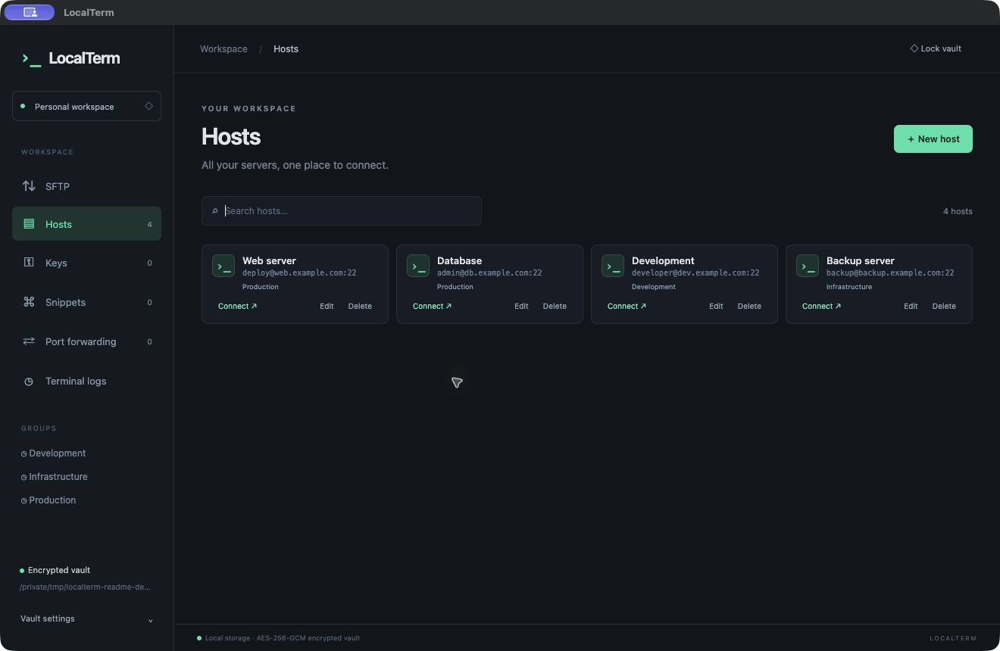

# LocalTerm 1.8.0 — Windows



## Installation

Download the [portable EXE](https://github.com/x0r3n/LocalTerm/releases/download/v1.7.0/LocalTerm-1.7.0-Windows-x64-Portable.exe), or extract the complete [Windows ZIP](https://github.com/x0r3n/LocalTerm/releases/download/v1.7.0/LocalTerm-1.7.0-Windows-x64.zip) and run `LocalTerm.exe` with its accompanying files in place. The portable EXE extracts and runs the app. These packages target Intel/AMD x64; there is no separate Windows ARM build. They are unsigned and do not require Node.js or Electron. Close the old app before replacing it and keep your vault file.

## Shortcuts

| Shortcut | Action |
|---|---|
| Ctrl+T | New searchable tab |
| Ctrl+K | Focus search |
| Ctrl+R | Return to the last session |
| Escape | Close host picker or cancel a drag |

## Getting started

1. Select **Create a new vault**, choose a password of at least 12 characters and a location, or use **Choose a vault file…** and **Unlock vault**. The last successfully opened path is remembered, but the password is not.
2. Under **Keys**, add or import a private key. The key is stored inside the encrypted vault.
3. Under **Hosts → New host**, enter the address, port, username, credentials and optional group and jump hosts. Save changes.
4. Connect and verify the server fingerprint against a trusted source. A changed fingerprint blocks the connection.

## Terminals

Open additional searchable tabs with the new-tab shortcut. Drag a terminal tab or pane handle to another pane's edge to create a split Workspace. Other tabs remain separate. Up to six panes are supported; closing a pane expands those remaining. A session closed with `exit` or Ctrl+D closes its tab. Right-click a tab and choose **Duplicate** to open a second connection. **Return to session** returns from the host list to the last terminal.

Under **Hosts → Edit → Terminal theme**, choose Default, Ember Dune, Emerald, Paper, or Custom. Custom allows background, text, cursor and selection colors. Saved changes apply to open terminals for that host. **Vault settings → Terminal clipboard** controls copy on selection and paste on right-click, enabled by default.

## Two-pane SFTP

Open **SFTP** in the sidebar after unlocking. Browse local files on the left and search for a host and connect on the right. The independent connection uses saved credentials, jump hosts and fingerprint verification. Double-click folders, use the path field, Up or Refresh, and select files using checkboxes or **Select all**. Upload and Download copy the selection to the other panel. For name conflicts choose Overwrite, Rename (keep both), Skip or Cancel remaining; apply the choice to all remaining conflicts if desired. Results report completed, skipped and failed files.

Delete requires confirmation and permanently removes selected files or empty folders. Copy supports regular files; whole folders and symbolic links cannot be copied. Locking the vault closes the SFTP connection and clears the panels.

## Port forwarding and jump hosts

Under **Port forwarding → New forwarding rule**, select Local, Remote or Dynamic (SOCKS5), specify the SSH host, listening address and port and, where applicable, destination, then save and Start. Stop closes the tunnel. Rules are stored in the vault. Configure ordered jump hosts in the host editor; each hop uses its own authentication and fingerprint verification. Terminal, SFTP and forwarding connections use the configured route. A route supports up to eight hosts including the destination.

## Vault settings and storage

Automatic locking can be disabled or configured with an inactivity interval and separate screen-lock and sleep options. The default is 15 minutes with all options enabled. Manual locking and exiting still close connections. Vault settings also provide importing another encrypted LocalTerm vault, saving an encrypted copy, opening another vault and changing the password; existing copies retain their old password.

The vault uses AES-256-GCM and scrypt (`N=65536, r=8, p=1`); its password is not stored. Saving uses a temporary file, synchronization and rename, and detects external changes. This is not a multi-device locking protocol: when using iCloud or another sync service, keep the file downloaded, edit on one device at a time, wait for synchronization and keep backups. There is no password recovery service. macOS and Windows use the same vault format.

## Updates

After the first vault unlock each day, LocalTerm checks the latest stable GitHub release. **Vault settings → Check for updates** checks immediately. If an update is available, choose **Update now** or **Later**; installation is never automatic. The app verifies the download size and SHA-256 digest, closes connections, locks the vault, replaces the app and restarts. The previous application is retained with a `.previous-<timestamp>` suffix. The installation location must be writable. Versions older than 1.6.0 require a manual update first.

## Development and limitations

The application uses JavaScript/CommonJS, Electron, xterm.js and ssh2. Node.js 22+ and npm are required for development:

```sh
npm ci
npm test
npm start
```

SSH integration tests use local TCP ports. For 1.7.0, 81 automated tests passed on macOS, including local SFTP batch operations. The Windows build has not been tested in a native Windows runtime. Mosh, serial connections, SSH-agent/FIDO2 and keyboard-interactive MFA are not implemented. Ed25519 OpenSSH keys are supported; export Ed25519 PPK keys as OpenSSH using PuTTYgen. No independent security audit has been performed.

## License

Copyright © 2026 x0r3n. LocalTerm is licensed under [GPL-3.0-only](../LICENSE); see [COPYRIGHT](../COPYRIGHT). There is no warranty. Third-party license notices remain applicable, including Electron and Chromium notices in the application packages. Rights granted for earlier MIT-licensed versions are unaffected.

Build the Windows x64 ZIP and portable EXE with `npm run build:win`.

## Compact terminal bar and logs (1.8.0)

Terminals use a single top tab bar with Workspace on the left. Right-click a tab for Layout, Duplicate, Close terminal, Browse files and Lock vault. Terminal logs appears below Port forwarding in the sidebar. Select a recent session to read its output. Vault settings controls the number of lines retained per terminal (default 2000, range 100–10000). Logs are saved in a separate encrypted local file every few seconds and when closing a terminal. Up to 50 sessions and 4 MB of log text are retained. An unexpected shutdown may lose the last few seconds.

## Local encrypted logs (1.8.1)

Logs are stored in the local application data folder, with their encryption key in the vault. Existing vault logs are migrated on first use. In Terminal logs, delete individual or all logs, or save and restore an encrypted archive. Restore requires the same vault key, so back up the vault as well. Logs are local to each machine.
